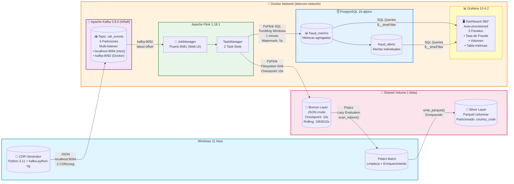

# Real-Time-Telecom-CDR-Fraud-Detection-Network-Analytics
__________________________________________________________________________________________________________________________________________________________________________________________________

__________________________________________________________________________________________________________________________________________________________________________________________________
     

## Sistema de Detección de Fraude en Tiempo Real para Telecomunicaciones
Arquitectura Medallón + Streaming + ML-Ready

📊 Ver Dashboard | 🏗️ Arquitectura | 🚀 Quick Start | 📈 Métricas de Negocio

Pipeline de procesamiento de streaming para detección de fraude en llamadas (CDR) y analítica de red, construido con un stack 100% Open Source, autohospedado, con visualización dinámica y arquitectura Medallion..
__________________________________________________________________________________________________________________________________________________________________________________________________
### 📋 Tabla de Contenido

🎯 Problema de Negocio

💡 Solución Propuesta

🏗️ Arquitectura
️ 
Stack Tecnológico

📁 Estructura del Proyecto

🚀 Quick Start

📊 Resultados en Vivo

📈 Impacto en el Negocio

🔑 Decisiones Arquitectónicas Clave

🛠️ Troubleshooting Highlights

Lo que Aprenderás

🚀 Próximos Pasos

__________________________________________________________________________________________________________________________________________________________________________________________________
## 🎯 Problema de Negocio

Las operadoras de telecomunicaciones pierden $38.1 billones USD anualmente por fraude telefónico (CFCA 2023). Los sistemas tradicionales de detección:

* ❌ Procesan datos en batch (horas/días de retraso)

* ❌ No detectan patrones de ataque en tiempo real

* ❌ Generan falsos positivos que afectan clientes legítimos

* ❌ No escalan con el volumen de CDRs (Call Detail Records)

Este proyecto resuelve estos problemas con una arquitectura de streaming end-to-end.
__________________________________________________________________________________________________________________________________________________________________________________________________
## 💡 Solución Propuesta

Sistema de detección de fraude en tiempo real que procesa CDRs desde su generación hasta la visualización en dashboard en menos de 60 segundos, utilizando:

* Apache Kafka para ingestión de eventos en tiempo real

* Apache Flink para procesamiento de streaming con ventanas de tiempo

* Arquitectura Medallón (Bronze → Silver → Gold) para calidad de datos

* PostgreSQL para almacenamiento de métricas

* Grafana para visualización en tiempo real

__________________________________________________________________________________________________________________________________________________________________________________________________
### 🎯 Características Clave

✅ Latencia < 60 segundos desde la llamada hasta la alerta

✅ Procesamiento de 120+ CDRs/minuto en tiempo real

✅ Detección de patrones por país, duración y frecuencia

✅ Arquitectura escalable lista para producción

✅ 100% containerizado con Docker Compose

__________________________________________________________________________________________________________________________________________________________________________________________________
## 🏗️ Arquitectura

Diagrama de Flujo de Datos

## 🏗️ Arquitectura del Proyecto

______________________________________________________________________________________________________________________
## Arquitectura Medallón

 

🚀 Estado del Proyecto
- [x] Fase 1: Configuración del entorno (Docker, Git, WSL2)
- [ ] Fase 2: Kafka KRaft y generación de CDRs sintéticos
- [ ] Fase 3: Procesamiento en tiempo real con PyFlink
- [ ] Fase 4: Detección de fraude por ventanas temporales
- [ ] Fase 5: Lakehouse con MinIO + Iceberg + PySpark
- [ ] Fase 6: Monitorización, visualización y CI/CD
      
______________________________________________________________________________________________________________________
## 🛠️ Stack Tecnológico
- **Ingesta:** Apache Kafka (KRaft mode, sin ZooKeeper)
- **Streaming:** Apache Flink + PyFlink
- **Almacenamiento:** MinIO + Apache Iceberg
- **Batch:** Apache Spark + PySpark
- **Orquestación y Calidad:** Airflow + Great Expectations + dbt Core

