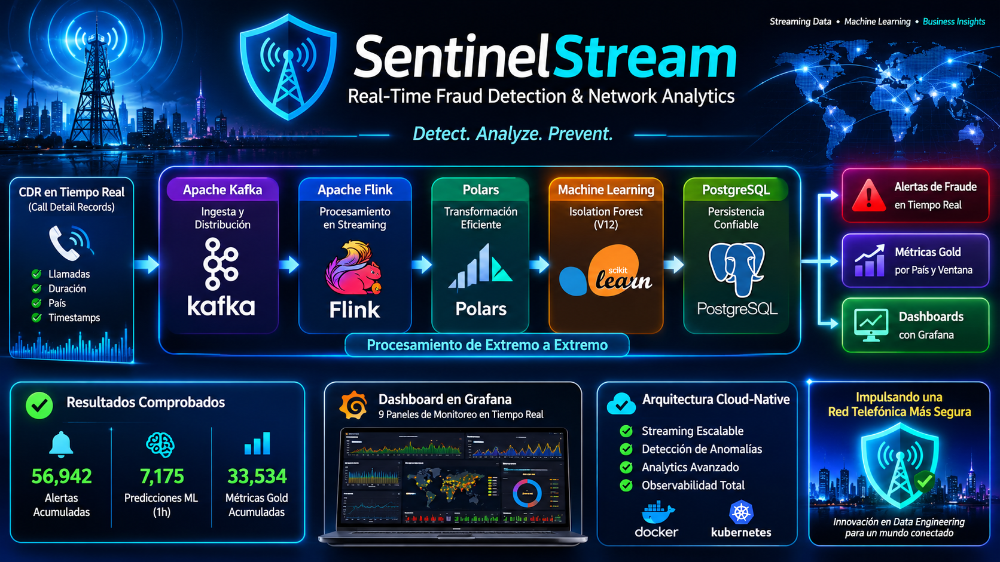
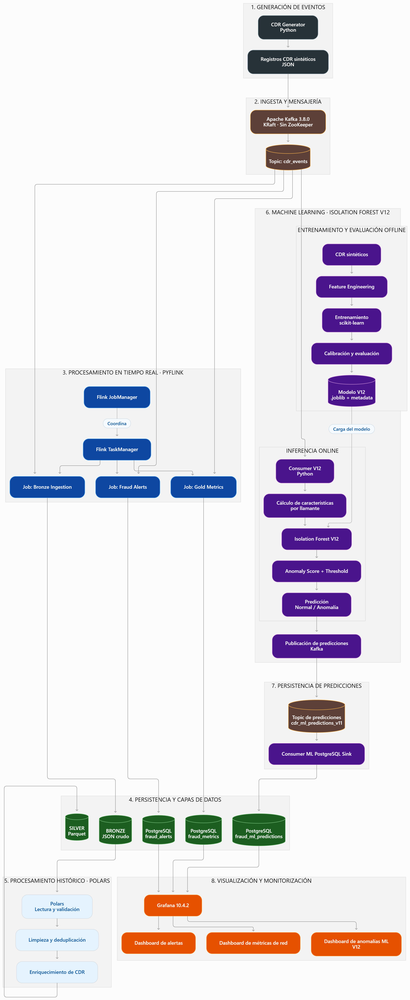

# SentinelStream – Real-Time Telecom CDR Fraud Detection & Network Analytics

Plataforma local de ingeniería de datos orientada al procesamiento de registros de llamadas telefónicas (Call Detail Records, CDR), detección experimental de anomalías y análisis de métricas de red mediante tecnologías open source y autohospedadas.

SentinelStream implementa una arquitectura de streaming basada en Apache Kafka y Apache Flink, procesamiento histórico con Polars, persistencia en PostgreSQL y monitorización con Grafana. Incorpora inferencia online con Isolation Forest V12, cuyo entrenamiento y evaluación se realizan offline.


## Arquitectura

### Flujo integral de datos — SentinelStream

La arquitectura separa el procesamiento de eventos en tiempo real, el procesamiento histórico y el ciclo de Machine Learning. Isolation Forest V12 participa en la inferencia online; su entrenamiento y evaluación se realizan offline.

<p align="center">
  
</p>

**Recorrido de los datos**

1. **Ingesta:** el generador Python produce eventos CDR y los publica en Apache Kafka mediante KRaft.
2. **Streaming:** Apache Flink procesa los eventos, genera alertas y calcula métricas por ventanas.
3. **Procesamiento histórico:** los datos Bronze en JSON se validan y transforman con Polars para generar archivos Silver en Parquet.
4. **Machine Learning:** Isolation Forest V12 se entrena y calibra offline. Su artefacto se utiliza en el consumidor de inferencia online, que publica predicciones en Kafka.
5. **Persistencia:** PostgreSQL almacena alertas, métricas agregadas y predicciones ML.
6. **Visualización:** Grafana consulta PostgreSQL para mostrar el comportamiento del sistema y las detecciones de anomalías.

**Nota técnica:** el topic `cdr_ml_predictions_v11` conserva su nombre histórico por compatibilidad; el modelo que realiza la inferencia es V12. El entrenamiento offline y la inferencia online son procesos distintos.

## Stack tecnológico

| Componente | Tecnología | Función |
|---|---|---|
| Generación de datos | Python | Generación de CDR sintéticos |
| Ingesta | Apache Kafka 3.8.0 | Transporte de eventos mediante KRaft |
| Streaming | Apache Flink 1.18.1 / PyFlink | Procesamiento de eventos y métricas |
| Bronze | JSON | Conservación de registros originales |
| Silver | Polars | Limpieza y transformación histórica por lotes |
| Formato columnar | Apache Parquet | Almacenamiento de datos procesados |
| Gold | PostgreSQL | Persistencia de métricas |
| Machine Learning | Python / scikit-learn | Detección experimental de anomalías |
| Inferencia online | Isolation Forest V12 | Scoring de eventos consumidos desde Kafka |
| Experimentos offline | Isolation Forest V11 / V12 | Entrenamiento, calibración y evaluación |
| Persistencia de predicciones | PostgreSQL | Almacenamiento de resultados de inferencia |
| Visualización | Grafana 10.4.2 | Monitorización y dashboards |
| Contenedores | Docker Compose | Entorno local autohospedado |

## Organización del proyecto

```text
telecom-cdr-fraud-detection/
│
├── docker/
│   └── grafana/
│       └── provisioning/
│           ├── dashboards/
│           └── datasources/
│
├── docs/
│   ├── ARCHITECTURE.md
│   ├── DECISIONS.md
│   ├── EXECUTION_GUIDE.md
│   ├── LESSONS_LEARNED.md
│   ├── TESTING.md
│   └── TROUBLESHOOTING.md
│
├── experiments/
│   ├── models/
│   │   ├── isolation_forest_v11_baseline.joblib
│   │   ├── isolation_forest_v11_baseline.json
│   │   ├── isolation_forest_v12_baseline.joblib
│   │   └── isolation_forest_v12_baseline.json
│   ├── results/
│   │   ├── anomaly_evaluation_v11.txt
│   │   ├── anomaly_evaluation_v12.txt
│   │   └── rules_evaluation_v1.txt
│   ├── build_cdr_features_v1.py
│   ├── evaluate_rules_v1.py
│   ├── evaluate_v12_production.py
│   ├── export_baseline_v11.py
│   ├── generate_synthetic_cdr_v10.py
│   ├── generate_synthetic_cdr_v12.py
│   ├── train_anomaly_v11.py
│   └── train_anomaly_v12.py
│
├── scripts/
│   ├── init_postgres.sql
│   └── start_sentinelstream.ps1
│
├── src/
│   ├── flink_jobs/
│   │   ├── bronze_ingestion.py
│   │   ├── fraud_alerts.py
│   │   └── gold_layer.py
│   ├── inference/
│   │   ├── consumer_v11.py
│   │   ├── consumer_v12.py
│   │   └── ml_predictions_to_postgres.py
│   ├── polars_jobs/
│   │   ├── silver_layer.py
│   │   ├── silver_layer_v4.py
│   │   └── silver_layer_v5.py
│   └── producers/
│       ├── cdr_generator.py
│       └── requirements.txt
│
├── tests/
│   ├── README.md
│   └── test_consumer_v11.py
│
├── requirements/
│   ├── dev.txt
│   ├── inference.txt
│   ├── ml-experiments.txt
│   ├── producer.txt
│   └── silver.txt
│
├── .env.example
├── .gitignore
├── docker-compose.yml
├── Dockerfile.flink
├── LICENSE
└── README.md
```

*Nota: el árbol muestra los componentes principales y no enumera todos los archivos históricos ni los artefactos generados.*

## Procesamiento de datos: arquitectura Medallion

### Bronze – Ingesta de datos crudos

- Generación de registros CDR sintéticos mediante Python.
- Ingesta de eventos a través de Apache Kafka.
- Procesamiento de streaming con Apache Flink y PyFlink.
- Conservación de registros en formato JSON.

### Silver - Procesamiento y transformación

El procesamiento histórico se realiza mediante Polars sobre los archivos JSON
conservados en Bronze. Las salidas se almacenan en formato Apache Parquet.
Silver es un proceso por lotes que genera snapshots independientes; no es una
capa de streaming continuo ni alimenta directamente Gold o la inferencia V12.

**Evolución de las versiones:**

- **V3:** versión histórica inicial del procesamiento Silver.
- **V4:** incorpora la normalización de `is_burst_event` nulo a `false`,
  conserva las columnas de eventos Burst y genera `silver_data_v4.parquet`.
- **V5:** versión más reciente auditada. Genera `silver_data_v5.parquet`
  y conserva las transformaciones de clasificación y duración.

**Transformaciones implementadas:**

- Validación de campos obligatorios y duración no negativa.
- Deduplicación por `call_id`.
- Normalización de `is_burst_event` nulo a `false`.
- Conservación de `burst_id` y `burst_call_index`.
- Generación de `duration_minutes`.
- Clasificación de duración: `short`, `medium` y `long`.
- Identificación de llamadas internacionales.
- Escritura en Apache Parquet mediante Polars.

**Auditoría histórica de V4:**

| Indicador | Resultado |
|---|---:|
| Registros Silver | 380,877 |
| Registros con Burst `false` | 380,710 |
| Registros con Burst `true` | 167 |
| Valores nulos en `is_burst_event` | 0 |
| `call_id` duplicados | 0 |
| Duraciones negativas | 0 |
| Registros históricos sin campo Burst normalizados a `false` | 374,602 |

Los 374,602 registros históricos que no contenían `is_burst_event` se
normalizaron a `false`. Esto representa la ausencia del indicador en esos
registros; no constituye una etiqueta de fraude ni una clasificación confirmada
de comportamiento normal.

V4 procesó 4,502 registros más que el snapshot utilizado por V3 porque esos
registros llegaron posteriormente a Bronze.

**Auditoría de Silver V5:**

| Indicador | Resultado |
|---|---:|
| Archivos Bronze leídos | 17,476 |
| Registros Silver | 383,185 |
| `call_id` únicos | 383,185 |
| Valores nulos en `is_burst_event` | 0 |
| Registros con Burst `false` | 382,942 |
| Registros con Burst `true` | 243 |
| Registros `short` | 39,704 |
| Registros `medium` | 165,185 |
| Registros `long` | 178,296 |
| Tamaño del Parquet generado | 9.6 MB |

El archivo generado es `data/silver_data/silver_data_v5.parquet`.

El proceso se ejecuta mediante `src/polars_jobs/silver_layer_v5.py` y es independiente del script `start_sentinelstream.ps1` y del despliegue Docker Compose.
Sus columnas incluyen `call_id`, `caller`, `callee`, `duration_sec`,
`country_code`, `timestamp`, `is_suspicious`, `is_burst_event`, `burst_id`,
`burst_call_index`, `duration_minutes`, `call_type` e `is_international`.

V5 es un snapshot histórico por lotes. No se ejecuta como un flujo continuo,
no alimenta directamente la tabla Gold y no constituye la entrada del consumer
online V12. Los indicadores proceden de datos sintéticos y no representan
evidencia de fraude real.

### Gold – Métricas y persistencia

- Procesamiento de métricas mediante Apache Flink.
- Persistencia en PostgreSQL.
- Visualización mediante Grafana.
- Monitorización de indicadores y tasa de fraude por país.

## Machine Learning: entrenamiento e inferencia

El proyecto conserva los experimentos V11 y V12. V11 es la versión histórica
de la integración online. V12 es el modelo utilizado actualmente por el
consumer de inferencia online; su entrenamiento y evaluación se realizan
offline, de forma independiente del proceso de inferencia.

### V11 - Versión histórica

Se desarrolló un baseline con Isolation Forest de scikit-learn para evaluar
la detección de anomalías en registros CDR sintéticos.

**Configuración:**

- Algoritmo: Isolation Forest.
- Número de estimadores: 300.
- Contamination: 0.05.
- Características: 4 variables de comportamiento.
- Semilla aleatoria: 42.
- Selección del umbral mediante conjunto de calibración.

**Partición de datos:**

- 300 llamantes para entrenamiento.
- 100 llamantes para calibración.
- 100 llamantes para prueba.

**Resultados experimentales históricos:**

| Métrica | Resultado |
|---|---:|
| Accuracy | 0.9790 |
| Precision | 0.9647 |
| Recall | 0.9245 |
| F1-score | 0.9441 |
| PR-AUC | 0.8973 |
| ROC-AUC | 0.9609 |
| TP | 355 |
| FP | 13 |
| TN | 1,603 |
| FN | 29 |

También se evaluó una variante ampliada con `is_new_destination_24h`.
El baseline obtuvo un F1-score de 0.9441 frente a 0.9318 de la variante
ampliada.

V11 tuvo una integración online histórica mediante `consumer_v11.py`.
El tráfico sintético mostró una tasa de alertas elevada, por lo que esa
integración no se considera validada para detección operativa de fraude.
V11 se conserva como antecedente técnico y experimental.

### V12 - Entrenamiento offline y evaluación

V12 amplía el experimento con un conjunto sintético de mayor tamaño y una
evaluación independiente por abonado.

**Dataset:**

| Elemento | Cantidad |
|---|---:|
| Registros CDR | 518,400 |
| Abonados | 500 |
| Episodios sintéticos | 1,058 |
| Entrenamiento | 300 abonados |
| Calibración | 100 abonados |
| Prueba | 100 abonados |

**Configuración:**

- Algoritmo: Isolation Forest.
- Estimadores: 300.
- Contamination: 0.05.
- Semilla aleatoria: 42.
- Variables de comportamiento:
  - `prior_calls_1m`
  - `prior_calls_5m`
  - `prior_calls_15m`
  - `prior_unique_destinations_24h`

El umbral se seleccionó mediante F1 máximo en el conjunto de calibración,
con precisión como criterio de desempate.

**Resultados offline en el conjunto de prueba:**

| Métrica | Resultado |
|---|---:|
| Accuracy | 0.9883 |
| Precision | 0.8336 |
| Recall | 0.7031 |
| F1-score | 0.7628 |
| PR-AUC | 0.7143 |
| ROC-AUC | 0.9434 |
| TP | 1,949 |
| FP | 389 |
| TN | 100,656 |
| FN | 823 |

**Artefactos principales:**

- `experiments/generate_synthetic_cdr_v12.py`
- `experiments/train_anomaly_v12.py`
- `experiments/evaluate_v12_production.py`
- `experiments/models/isolation_forest_v12_baseline.joblib`
- `experiments/models/isolation_forest_v12_baseline.json`
- `experiments/results/anomaly_evaluation_v12.txt`
- `experiments/results/anomaly_predictions_v12.parquet`
  (generado localmente; excluido de Git).

### V12 - Inferencia online

El modelo V12 se utiliza en el proceso independiente
`src/inference/consumer_v12.py`.

**Flujo de inferencia:**

1. Consume eventos CDR del topic Kafka `cdr_events`.
2. Mantiene estado de comportamiento por llamante para calcular variables
   temporales.
3. Carga `isolation_forest_v12_baseline.joblib` y sus metadatos.
4. Calcula el anomaly score y aplica el umbral configurado.
5. Publica predicciones en `cdr_ml_predictions_v11`.
6. El proceso independiente `ml_predictions_to_postgres.py` consume esas
   predicciones y las persiste en `public.fraud_ml_predictions`.

**Detalles de implementación:**

- Kafka accesible desde el host mediante `localhost:9094`.
- El topic conserva el nombre histórico `cdr_ml_predictions_v11` por
  compatibilidad; los registros auditados identifican el modelo como
  `SentinelStream V12 baseline`, versión `V12`.
- El consumer conserva el identificador histórico de grupo
  `sentinelstream-v11-inference`.
- Mantiene estado local mediante SQLite.
- Implementa una cola de salida (*outbox*) para publicar predicciones
  pendientes.
- El sink PostgreSQL es un proceso separado y utiliza el grupo
  `sentinelstream-ml-postgres-sink`.
- Las predicciones se almacenan en `public.fraud_ml_predictions`.

La integración online y la persistencia en PostgreSQL fueron verificadas
mediante registros identificados como V12. Esto confirma el funcionamiento
técnico observado, pero no demuestra precisión sobre fraude real ni garantiza
entrega exactamente una vez ante cualquier fallo.

Los resultados offline de V12 y los registros observados durante la inferencia
online representan contextos distintos y no deben mezclarse.

### Limitaciones de Machine Learning

- Los registros y las etiquetas utilizados son sintéticos.
- Los resultados offline no demuestran rendimiento con fraude real.
- V11 y V12 corresponden a experimentos diferentes y no son una comparación
  directa sobre un mismo conjunto de prueba.
- El score de Isolation Forest no representa una probabilidad calibrada
  de fraude.
- Una anomalía detectada no equivale a un fraude confirmado.
- La integración histórica V11 mostró una tasa elevada de alertas.
- V12 cuenta con inferencia online integrada, pero requiere validación con
  datos representativos, calibración y evaluación antes de cualquier uso
  operativo.

## Instalación y ejecución

El proyecto utiliza entornos virtuales independientes para evitar conflictos entre dependencias.

Consulta la documentación para los procedimientos completos:

- `docs/EXECUTION_GUIDE.md`: guía de ejecución.
- `docs/TESTING.md`: validaciones y pruebas.
- `docs/TROUBLESHOOTING.md`: resolución de problemas.
- `docs/ARCHITECTURE.md`: arquitectura técnica.
- `docs/DECISIONS.md`: decisiones de diseño.

## Pruebas

La suite automatizada disponible corresponde al consumer histórico V11.
Contiene diez pruebas para escenarios como eventos duplicados, eventos tardíos,
ventanas temporales, recuperación de estado, fallos de inferencia, outbox,
mensajes inválidos y tombstones de Kafka.

Ejecución documentada:

```powershell
.\src\inference\venv\Scripts\python.exe -m pytest .\tests\test_consumer_v11.py -v
```

Última validación documentada: 10 pruebas aprobadas.

Estas pruebas importan `consumer_v11.py`; no constituyen una suite para
`consumer_v12.py`. No se deben considerar aprobadas pruebas adicionales
sin ejecutarlas y verificar sus resultados.

## Objetivos técnicos del proyecto

SentinelStream permite demostrar experiencia práctica en:

- Arquitecturas de streaming con Apache Kafka.
- Procesamiento de eventos con Apache Flink y PyFlink.
- Diseño de pipelines de datos Bronze y Silver.
- Procesamiento columnar con Polars y Apache Parquet.
- Persistencia analítica en PostgreSQL.
- Observabilidad y dashboards con Grafana.
- Integración de modelos de Machine Learning con consumidores Kafka.
- Entrenamiento, calibración y evaluación de modelos de anomalías.
- Desarrollo y documentación de sistemas open source autohospedados.

## Estado y alcance

SentinelStream es un proyecto de portafolio orientado a ingeniería de datos,
procesamiento de eventos en tiempo real y experimentación con detección de
anomalías.

La arquitectura integra generación de CDR sintéticos, Kafka en modo KRaft,
procesamiento de streaming con Flink, almacenamiento Bronze, procesamiento
histórico Silver con Polars, métricas Gold en PostgreSQL y monitorización
mediante Grafana.

La inferencia online utiliza Isolation Forest V12 mediante un consumer Kafka
independiente y un sink separado para persistir predicciones en PostgreSQL.
V11 se conserva como versión histórica. Silver V5 representa un procesamiento
histórico por lotes y no alimenta directamente la inferencia online ni Gold.

Los resultados de Machine Learning se obtuvieron con datos sintéticos.
Las anomalías identificadas no constituyen evidencia de fraude real. El
proyecto continúa sujeto a mejoras de validación, calibración y evaluación
con datos representativos.

## Licencia

This project is licensed under the MIT License. See the [LICENSE](LICENSE) file for details.